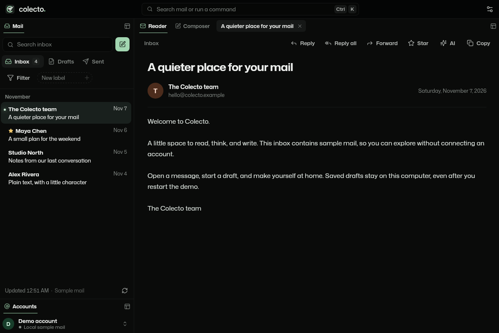
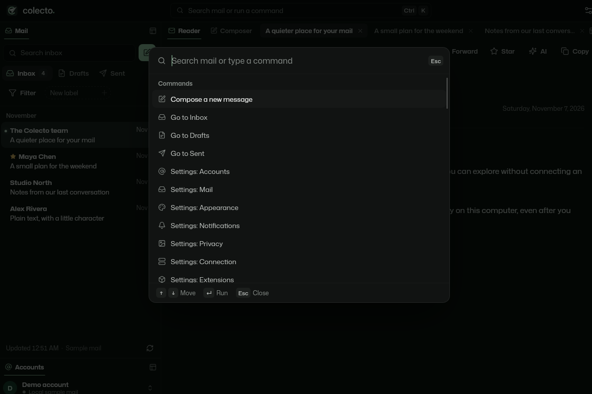
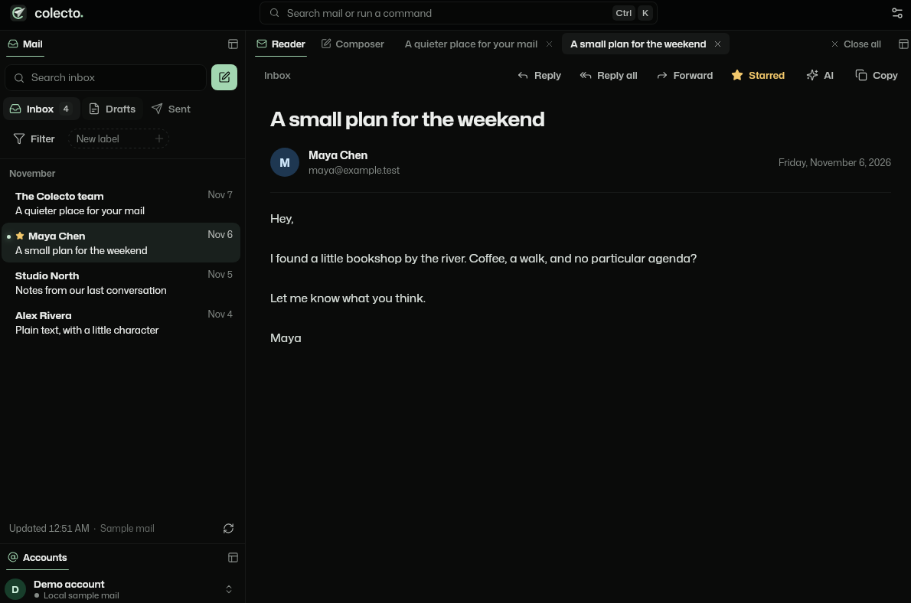

<p align="center">
  
</p>

<h1 align="center">Colecto</h1>

<p align="center">
  <b>A quiet, keyboard-friendly email client for IMAP/SMTP and JMAP.</b><br>
  Rust core, a Svelte interface built from swappable extensions,<br>
  and a daemon you can host yourself.
</p>

<p align="center">
  <a href="https://github.com/hexvale-labs/colecto/releases/latest"></a>
  <a href="https://github.com/hexvale-labs/colecto/actions/workflows/ci.yml"></a>
  <a href="https://github.com/hexvale-labs/colecto/pkgs/container/colectod"></a>
  
  
</p>

<p align="center">
  <a href="https://github.com/hexvale-labs/colecto/releases/latest"><b>Download</b></a> ·
  <a href="docs/self-hosting.md"><b>Self-host</b></a> ·
  <a href="docs/extensions/guide.md"><b>Write an extension</b></a> ·
  <a href="docs/README.md"><b>Docs</b></a> ·
  <a href="docs/roadmap.md"><b>Roadmap</b></a>
</p>

<p align="center">
  
</p>

> [!NOTE]
> Colecto is in beta. It works with real mail accounts, and updates migrate your data
> forward; going back to an older version is not supported.

## Why Colecto

- **Your mail, your server.** Run the daemon yourself and it keeps receiving mail while
  every app is closed. Or skip it and use the desktop app on its own.
- **Your interface.** Every mail view is an extension. Rearrange panes like an editor,
  swap views, or write your own.
- **Safe by default.** HTML mail renders in a script-free sandbox, remote images wait
  for your OK, and automation never sends anything without your approval.

<table>
  <tr>
    <td width="50%"></td>
    <td width="50%"></td>
  </tr>
  <tr>
    <td align="center"><sub>Jump anywhere with <kbd>Ctrl</kbd>+<kbd>K</kbd></sub></td>
    <td align="center"><sub>Messages open as tabs in panes you can rearrange</sub></td>
  </tr>
</table>

## Features

### Mail

- **IMAP/SMTP and JMAP**, side by side, with as many accounts as you like
- **New mail in seconds** through IMAP IDLE and JMAP push, with polling as a fallback
- **Reply, reply all and forward**, with attachments in both directions
- **Search** Inbox and Sent through your provider
- **Local drafts and labels**, kept in a single embedded database

### Interface

- **Your layout:** panes split, tab and dock like an editor, and the layout follows
  you between devices
- **Keyboard first:** command palette (<kbd>Ctrl</kbd>+<kbd>K</kbd>), <kbd>C</kbd> to
  compose, keyboard-resizable panes
- **Your accent colour**, on a calm dark interface
- **Notifications** in the app and on the desktop, positioned where you want them

### Privacy and safety

- **Sandboxed HTML mail**, with remote images loaded only when you allow them (or
  automatically, if you choose in **Settings → Privacy**)
- **Encrypted credentials**, protected by your system keychain or a master password

### Extensions and automation

- **Extensions:** mail views are extensions. Third-party extensions run in an isolated
  Web Worker and describe their interface as components Colecto draws, with optional
  background work in a WebAssembly sandbox ([make your own](docs/extensions/guide.md))
- **Automation with guard rails:** scoped API keys and an MCP server, with your
  approval required before anything is sent

### Hosting and platforms

- **Self-hostable daemon** with [Docker](docs/self-hosting.md), systemd or any other
  supervisor
- **Linux, Windows, Android and the browser**

Have an idea? [Open an issue](https://github.com/hexvale-labs/colecto/issues/new) and
tell us about it.

## Get started

1. [Download Colecto](https://github.com/hexvale-labs/colecto/releases/latest) for your
   system. The builds are not code-signed; [here is how to install them](docs/install.md).
2. Open **Settings → Accounts** and add your IMAP/SMTP or JMAP account.
3. Optional: host the daemon so mail keeps arriving while your devices are off, then
   point every app at it in **Settings → Servers**.

### Host the daemon

You need a domain name pointing at a server, with ports 80 and 443 open.

```sh
mkdir colecto && cd colecto
curl -fsSLO https://raw.githubusercontent.com/hexvale-labs/colecto/main/packaging/docker/compose.yaml
echo "COLECTO_DOMAIN=mail.example.org" > .env
docker compose up -d
docker compose exec colecto cat /data/access-token
```

That starts Colecto behind [Caddy](https://caddyserver.com), which gets a TLS
certificate for you, and prints the access token to paste into the browser or the app.
[Self-hosting](docs/self-hosting.md) covers credentials in a container, configuration
and other supervisors.

To build and run from a checkout instead, see [development](docs/development.md).

## What's next

Work in progress and planned:

- Read/unread, star, archive, delete and move (in progress)
- Browsing every folder with paging and incremental sync
- First-run onboarding, font choice and running the daemon as a background service
- Android notifications through UnifiedPush from your own daemon
- Conversation threading and inline (`cid:`) images
- Encryption of stored mail
- Hosting several users on one daemon

Not planned: POP3. See the [roadmap](docs/roadmap.md) for status.

## Documentation

Everything is indexed in [docs/README.md](docs/README.md).

| Topic | Page |
| --- | --- |
| Install | [Installing](docs/install.md), including [Apple builds](docs/install.md#apple-builds) (not in releases; build them yourself on a Mac) |
| Run a server | [Self-hosting](docs/self-hosting.md) |
| Accounts and credentials | [Accounts](docs/accounts.md) |
| Hack on Colecto | [Development](docs/development.md) and [architecture](docs/architecture.md) |
| Extend it | [Make your own extension](docs/extensions/guide.md) |

## Security

Please report vulnerabilities privately through
[GitHub security advisories](https://github.com/hexvale-labs/colecto/security/advisories/new),
not in public issues. See the [security policy](.github/SECURITY.md).

## License

Colecto is dual-licensed under [MIT](LICENSE-MIT) or [Apache-2.0](LICENSE-APACHE), at
your option.
